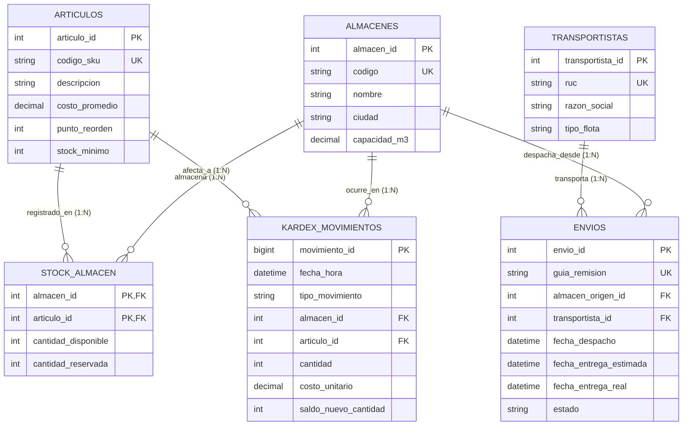

# 📦 Dataset: Operaciones y Logística (Gestión Multi-Almacén y Kardex)

Base de datos orientada al control físico y contable de inventarios multi-almacén, despachos por flota y movimientos de Kardex en tiempo real.

---

## 📊 Diagrama Entidad-Relación Interactivo (Mermaid)



---

## ⚡ Importación Rápida
```bash
mysql -u root -proot < 01_schema.sql
mysql -u root -proot operaciones_logistica < 02_data.sql
```
