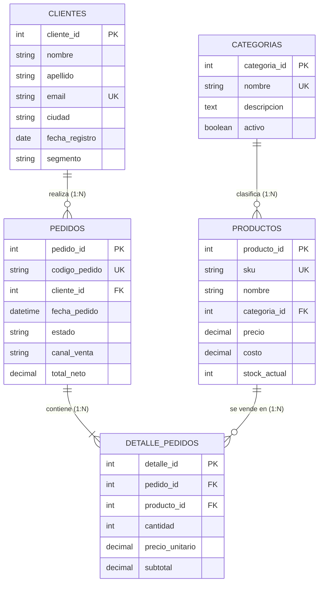

# 🛒 Dataset: Tienda Retail (E-Commerce & Omnicanal)

Base de datos simulada de una cadena de comercio minorista omnicanal (Web, Móvil, Físico) con transacciones, clientes y detalle de facturación.

---

## 📊 Diagrama Entidad-Relación Interactivo (Mermaid)



---

## ⚡ Importación Rápida
```bash
# Vía CLI directa
mysql -u root -proot < 01_schema.sql
mysql -u root -proot tienda_retail < 02_data.sql

# O mediante Docker
docker compose exec mysql-bootcamp mysql -u root -proot -e "source /datasets/tienda_retail/01_schema.sql;"
docker compose exec mysql-bootcamp mysql -u root -proot -e "source /datasets/tienda_retail/02_data.sql;"
```
