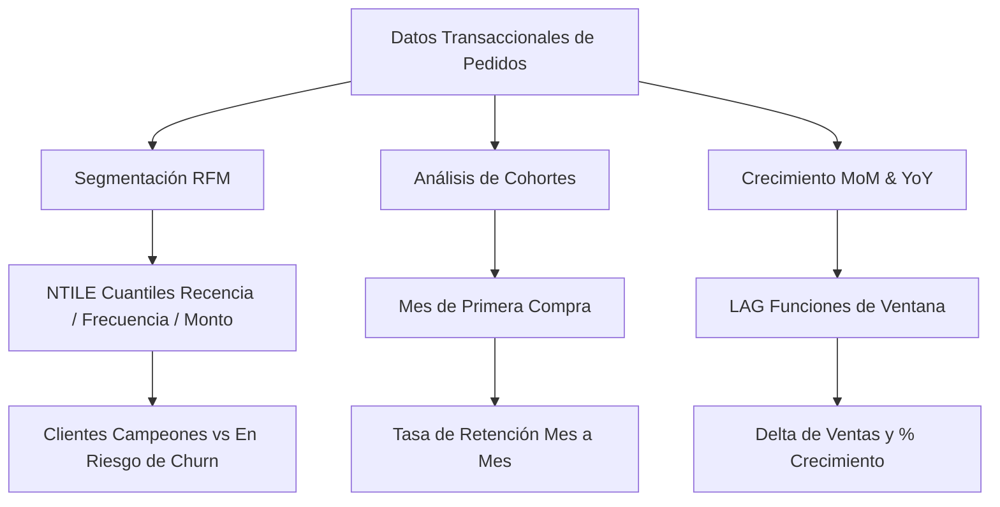

# 📊 Proyecto Final 1: Analítica de Negocio y Business Intelligence (Retail)

## 📌 Contexto del Negocio
Una compañía minorista omnicanal requiere implementar una capa analítica para la toma de decisiones basada en el comportamiento del consumidor y la rentabilidad por canal de venta.

---

## 🔄 Flujo Analítico del Proyecto (Mermaid)

---

## 🎯 Objetivos de Negocio
1. **Análisis de Cohortes**: Medir la retención de clientes según el mes de adquisición.
2. **Segmentación RFM (Recency, Frequency, Monetary)**: Clasificación de clientes mediante cuantiles (`NTILE(4)`).
3. **Métricas Temporales**: Variaciones Mes contra Mes (**MoM**) con `LAG()`.
4. **Análisis de Márgenes**: Detección del canal más rentable (Web vs App Móvil vs Tienda Física).

## 🗂️ Scripts Disponibles
- `queries.sql`: Solución guiada paso a paso comentada.
- `ejercicios.sql`: Retos analíticos adicionales con casos de prueba.
- `soluciones.sql`: Soluciones completas para auto-evaluación.
