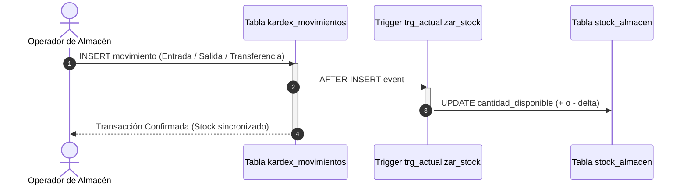

# 📦 Proyecto Final 2: Control de Inventarios con Kardex Automatizado

## 📌 Contexto del Negocio
Garantizar la consistencia contable y física de inventarios multi-almacén, erradicando discrepancias mediante **Triggers de actualización en tiempo real** y **Procedimientos transaccionales**.

---

## 🔄 Arquitectura de Integridad con Triggers (Mermaid)

---

## 🎯 Objetivos Técnicos
1. **Triggers Reactivos**: Mantener sincronizada la tabla `stock_almacen` automáticamente.
2. **Transferencias Atómicas Seguras**: Procedimiento almacenado `sp_transferir_articulos` con bloqueo pesimista `SELECT ... FOR UPDATE`.
3. **Indicador OTD (On-Time Delivery)**: Evaluación del porcentaje de entregas a tiempo por transportista.
