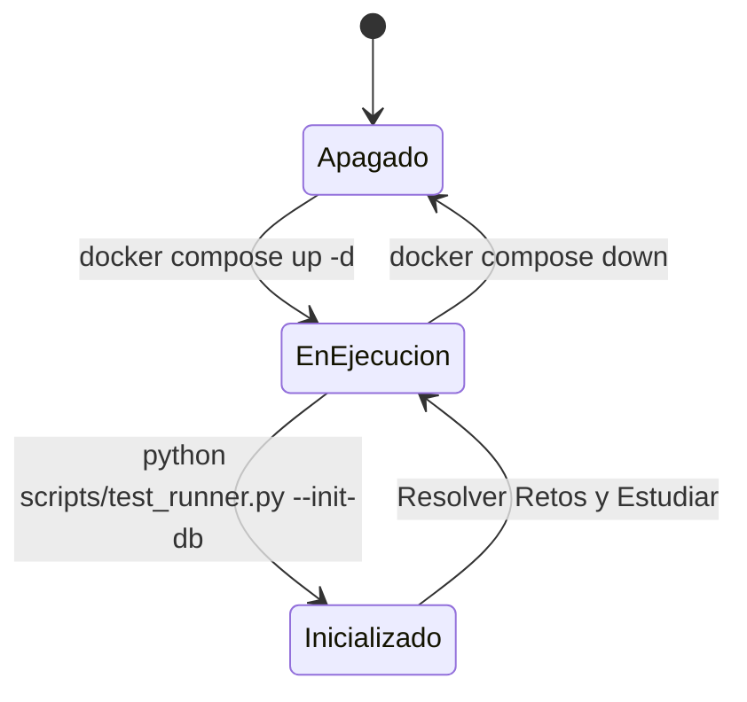

# 🐳 Guía Definitiva de Docker: Tu Laboratorio MySQL a Prueba de Errores

Esta guía está diseñada para que **nunca te atores con Docker**, sin importar si nunca lo has usado antes. Sigue estos pasos en orden estricto.

---

## 📋 1. Requisitos Previos (¿Qué necesitas tener instalado?)

Antes de tocar cualquier comando, asegúrate de tener instalados estos 3 componentes en tu computadora:

| Software | Para qué sirve | Dónde descargarlo | Detalle Crítico |
| :--- | :--- | :--- | :--- |
| **Docker Desktop** | El motor que levantará MySQL en un contenedor aislado. | [docker.com/products/docker-desktop](https://www.docker.com/products/docker-desktop/) | **En Windows:** Durante la instalación marca la casilla *"Use WSL 2 instead of Hyper-V"*. |
| **Python 3.10+** | Para ejecutar el validador automático de retos (`test_runner.py`). | [python.org/downloads](https://www.python.org/downloads/) | ⚠️ **VITAL:** En la primera pantalla del instalador, marca la casilla **"Add python.exe to PATH"**. |
| **DBeaver Community** | Tu interfaz gráfica para ver tablas, datos y escribir consultas con autocompletado. | [dbeaver.io/download](https://dbeaver.io/download/) | Descarga la versión *"Community Edition"* (gratuita y libre). |

> [!IMPORTANT]
> **Asegúrate de que Docker Desktop esté realmente abierto y corriendo:**  
> No basta con tenerlo instalado. Debes abrir el programa **Docker Desktop** desde el menú de inicio y esperar hasta que el ícono de la ballena en la barra de tareas esté en color verde o diga **"Engine running"**.

---

## 📍 2. La Regla de Oro: El Directorio de Trabajo (¿Dónde estás parado?)

> 🛑 **El 90% de los errores ocurren aquí:**  
> Si estás en `C:\Users\tu_usuario>` y ejecutas `docker compose up -d` o `python scripts/test_runner.py`, tu computadora te dirá:  
> `no configuration file provided: not found` o `El sistema no puede encontrar la ruta especificada`.

### 🧭 Cómo abrir tu terminal en el lugar EXACTO:

#### Método A (El más fácil desde el Explorador de Archivos de Windows):
1. Abre tu Explorador de Archivos y entra a la carpeta del proyecto:  
   `C:\Users\sersf\.gemini\antigravity\scratch\sql-mysql-bootcamp`
2. Haz clic en la **barra de direcciones** superior (donde se ve la ruta de las carpetas).
3. Escribe `powershell` y presiona `Enter`.
4. ¡Listo! Se abrirá la terminal directamente dentro del proyecto.

#### Método B (Desde VS Code):
1. Abre la carpeta `sql-mysql-bootcamp` en VS Code (**File $\rightarrow$ Open Folder**).
2. Abre la terminal integrada con el atajo `Ctrl + ñ` (o menú **Terminal $\rightarrow$ New Terminal**).

### 🔍 Comprobación de Seguridad (Test de los 5 segundos):
Escribe en tu terminal:
```powershell
ls
```
Debes ver obligatoriamente en la lista el archivo `docker-compose.yml` y las carpetas `datasets`, `scripts` y `tutoriales`.  
Si ves esos archivos, **estás en el lugar correcto**.

---

## ⚡ 3. El Ciclo de Vida del Contenedor (Los 4 Comandos Clave)

Todo el ciclo de tu laboratorio se resume en este diagrama:



### 1️⃣ Encender el Servidor MySQL:
```powershell
docker compose up -d
```
- El `-d` significa *detached* (segundo plano): enciende MySQL sin bloquear tu terminal.
- La primera vez descargará la imagen oficial de MySQL 8.0 (tarda unos 30-60 segundos según tu internet).

### 2️⃣ Verificar que el contenedor esté sano:
```powershell
docker compose ps
```
Deberás ver algo como esto:
```text
NAME             IMAGE          COMMAND                  SERVICE          CREATED         STATUS
mysql-bootcamp   mysql:8.0.36   "docker-entrypoint.s…"   mysql-bootcamp   2 minutes ago   Up 2 minutes (healthy)
```
Si dice `Up` y `(healthy)`, tu base de datos está lista para recibir consultas.

### 3️⃣ Cargar o Restaurar los Datos Limpios en UTF-8:
```powershell
python scripts/test_runner.py --init-db
```
Cargará las tablas de la tienda retail y operaciones logísticas sin errores de tildes o codificación.

### 4️⃣ Apagar el Servidor cuando termines de estudiar:
Para no consumir memoria RAM ni batería cuando termines tu sesión:
```powershell
docker compose down
```
*(No te preocupes: tus datos no se borran, quedan guardados de forma segura en un volumen de Docker).*

---

## 🛠️ 4. Solución a los Errores Más Comunes (Troubleshooting)

### 🔴 Error 1: `Ports are not available: exposing port TCP 0.0.0.0:3306 ... port is already allocated`
* **Por qué ocurre:** Ya tienes otra instancia de MySQL instalada en tu Windows (por ejemplo, de XAMPP, WAMP o un instalador antiguo de MySQL Server) que está ocupando el puerto 3306.
* **Solución:**
  1. Abre el menú Inicio de Windows y busca **"Servicios"** (`services.msc`).
  2. Busca en la lista `MySQL`, `MySQL80` o `wampmysqld`.
  3. Haz clic derecho y selecciona **Detener**.
  4. Vuelve a ejecutar `docker compose up -d`.

---

### 🔴 Error 2: `error during connect: ... npipe:////./pipe/docker_engine`
* **Por qué ocurre:** Docker Desktop está cerrado o aún no ha terminado de encender su motor interno de WSL 2.
* **Solución:**
  Abre la aplicación **Docker Desktop** desde Windows, espera 30 segundos hasta que la barra inferior esté verde con el mensaje "Engine running", y vuelve a intentar.

---

### 🔴 Error 3: DBeaver dice `Public Key Retrieval is not allowed`
* **Por qué ocurre:** MySQL 8.0 utiliza autenticación segura por defecto y bloquea a clientes nuevos que no declaran explícitamente permitir la llave pública.
* **Solución en DBeaver:**
  1. Haz clic derecho sobre tu conexión en DBeaver $\rightarrow$ **Edit Connection**.
  2. Ve a la pestaña **Connection settings** $\rightarrow$ **Driver properties**.
  3. Busca la propiedad `allowPublicKeyRetrieval` y cámbiala a `TRUE`.
  4. Busca la propiedad `useSSL` y cámbiala a `FALSE` (o `PREFERRED`).
  5. Presiona **Apply and Close** y reconecta.

---

### 🔴 Error 4: "Hice modificaciones raras en las tablas y quiero empezar 100% de cero"
* **Solución (El botón de reinicio maestro):**
  Ejecuta estos 3 comandos en orden:
  ```powershell
  # 1. Apaga el contenedor y destruye los datos antiguos corruptos
  docker compose down -v

  # 2. Levanta el contenedor completamente nuevo
  docker compose up -d

  # 3. Inicializa las tablas limpias con tildes impecables
  python scripts/test_runner.py --init-db
  ```

---

## 🎯 Resumen: Tu Rutina de Estudio Diaria en 3 Pasos

```powershell
# Paso 1: Abres la terminal en la carpeta del bootcamp y enciendes el entorno
cd "C:\Users\sersf\.gemini\antigravity\scratch\sql-mysql-bootcamp"
docker compose up -d

# Paso 2: Abres ejercicios.sql, escribes tu solución y la validas
python scripts/test_runner.py --modulo 03

# Paso 3: Al terminar tu día, apagas el contenedor
docker compose down
```
