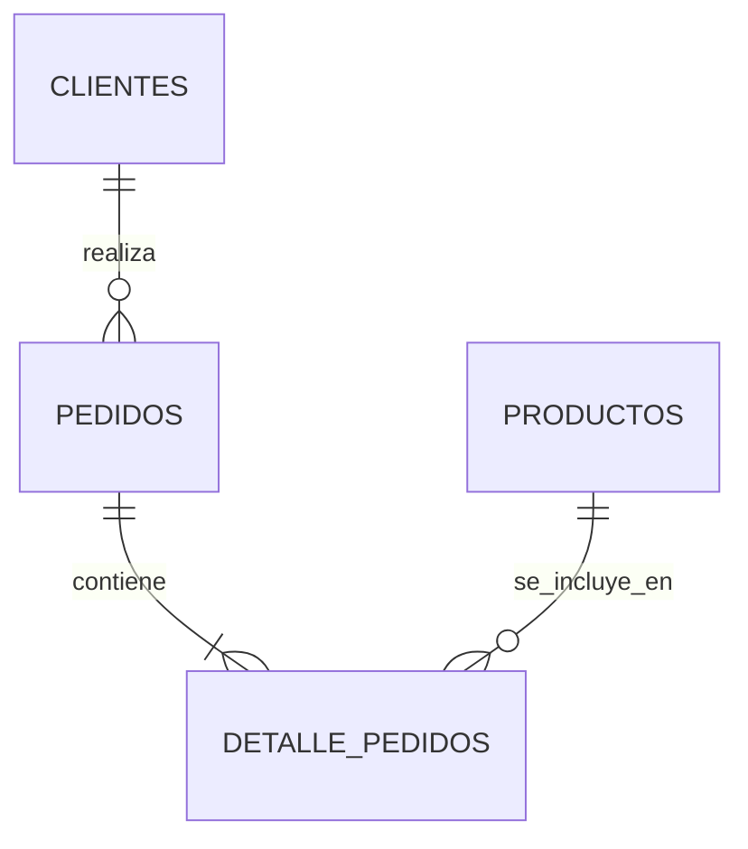

# 📊 Tutorial: Diagramas Entidad-Relación Nativos con Mermaid

GitHub soporta la renderización nativa de diagramas **Mermaid** sin necesidad de guardar capturas de pantalla o imágenes PNG pesadas.

---

## 📐 Anatomía de un Diagrama ER en Mermaid

Escribe en un bloque de código markdown con el identificador `mermaid`:

````markdown

````

### Simbología de Cardinalidad:
- `||--||` : Exactamente Uno a Uno ($1:1$)
- `||--o{` : Uno a Cero o Muchos ($1:0..N$)
- `||--|{` : Uno a Uno o Muchos ($1:1..N$)

---

## 🎨 Cómo editar y previsualizar en vivo
1. Abre este repositorio en **VS Code**.
2. Instala la extensión *"Markdown Preview Mermaid Support"*.
3. O visita la herramienta web oficial gratuita [mermaid.live](https://mermaid.live) para diseñar tus esquemas en tiempo real antes de copiarlos a tu código.
